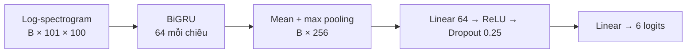
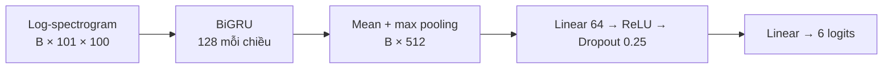
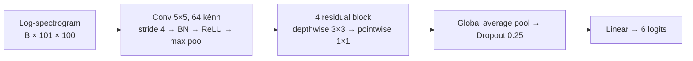

# VoiceSnake

Game Snake trên web, điều khiển bằng bốn từ **up, right, left, down** hoặc bằng bàn phím. Next.js chạy với Bun; model DS-CNN ONNX và âm thanh microphone được xử lý ngay trong trình duyệt.

## Chạy game

Cài [Bun](https://bun.sh/), sau đó tại thư mục dự án:

```bash
bun install
bun run dev
```

Mở địa chỉ localhost được in ra, chọn **Bắt đầu chơi**, sau đó chọn **Bật microphone** và cấp quyền. Nói một trong bốn từ tiếng Anh. Có thể dùng phím mũi tên, WASD hoặc các nút cảm ứng; Space tạm dừng. Micro cần localhost hoặc HTTPS. Model và runtime được tải khi mở trang; âm thanh không được gửi đến server.

Mục **Cài đặt** điều chỉnh ngay tốc độ rắn (2–10 ô/giây), confidence tối thiểu (10–99%), ngưỡng RMS (0,001–0,030), số lần xác nhận (1–4) và thời gian nghỉ giữa hai lệnh (0–1.000 ms). Mặc định lần lượt là 3 ô/giây, 70%, 0,004, 1 và 350 ms; **Đặt lại** khôi phục các giá trị này. Giảm ngưỡng hoặc xác nhận có thể giảm bỏ sót nhưng tăng nhận nhầm. Cài đặt chỉ tồn tại trong phiên trang; không thay đổi trọng số hay cấu trúc model.

```bash
bun test       # kiểm tra luật game, lọc lệnh và ONNX WASM
bun run build  # build production
bun run start  # chạy build
```

## Model được chọn

**DS-CNN vừa**, 21.830 tham số, được chọn vì trong lượt thử nó nhận đúng nhiều lệnh nhất sau ngưỡng (70,87%), với backbone PyTorch CPU p50 0,98 ms. Đây là phép đo clip rời trên một máy, không phải benchmark browser hoặc kết quả microphone production.

[Model ONNX](public/voicesnake.onnx) nhận float32 waveform mono 16 kHz `[B, 16000]`, trả về 6 logits `[B, 6]`: `up`, `right`, `left`, `down`, `unknown`, `background`. Frontend STFT được đóng gói trong model. Browser dùng ONNX Runtime Web WASM, ngưỡng confidence mặc định 0,70 và một lần dự đoán; `unknown` và `background` không phát lệnh. Ngưỡng này là lựa chọn thử nghiệm và cần kiểm tra lại với microphone thật; xem [so sánh ngưỡng](training/threshold_report.md).

ONNX Runtime CPU đã đối chiếu với PyTorch trên 128 clip: sai lệch logits tối đa 0,000109, không khác nhãn hoặc quyết định qua ngưỡng. Không suy ra tốc độ hay độ chính xác micro trên browser từ phép kiểm tra đó.

## So sánh ngưỡng confidence

Đo model ONNX trên clip rời. “Lệnh đúng” là tỷ lệ lệnh được nhận đúng; “từ lạ nhận nhầm” là tỷ lệ từ chưa thấy khi train bị nhận thành lệnh.

| Ngưỡng | Validation: lệnh đúng | Validation: từ lạ nhận nhầm | Test: lệnh đúng | Test: từ lạ nhận nhầm |
|---:|---:|---:|---:|---:|
| 0,70 | 86,0% | 21,56% | 83,7% | 8,44% |
| 0,80 | 82,6% | 13,75% | 80,0% | 4,38% |
| 0,85 | 80,0% | 11,88% | 77,7% | 3,75% |
| **0,90** | **75,5%** | **7,19%** | **73,4%** | **1,88%** |
| 0,919165 | 73,1% | 5,00% | 70,9% | 0,94% |
| 0,95 | 65,9% | 2,19% | 65,2% | 0,31% |

Mặc định hiện tại là **0,70** theo lựa chọn chơi thử; ngưỡng thấp hơn có thể tăng nhận nhầm. Kết quả chưa phản ánh microphone thật; test cũng đã được dùng trong quá trình chọn model. Xem [báo cáo chi tiết](training/threshold_report.md) để biết số mẫu và phép phát lại cửa sổ trượt.

## Dữ liệu và đầu vào chung

Speech Commands v0.02: audio mono 16 kHz, mỗi mẫu 16.000 điểm. Frontend dùng STFT (FFT/window 400, hop 160), gộp 200 bin tần số thành 100 bin, lấy log và chuẩn hóa theo từng mẫu. Kết quả là tensor **`[B, 101, 100]`**. Sáu logits theo thứ tự: `up`, `right`, `left`, `down`, `unknown`, `background`.

Split theo speaker bằng SHA-1, khoảng 70/15/15; không dùng split chính thức. `cat`, `dog` là unknown chưa thấy trong validation; `bed`, `bird` là unknown chưa thấy trong test. Tiếng nền được chia theo file trước khi cắt cửa sổ. Test có 2.503 clip lệnh, 4.320 unknown đã thấy, 320 unknown chưa thấy và 61 cửa sổ nền từ một file.

## Bốn kiến trúc

### GRU-64 — 80.582 tham số



### GRU-128 — 209.862 tham số



### DS-CNN nhỏ — 5.382 tham số


### DS-CNN vừa — 21.830 tham số, được chọn



Mỗi residual block gồm depthwise conv → batch norm → ReLU → pointwise conv → batch norm, cộng đầu vào rồi ReLU.

## Thông số train

| Thông số | Giá trị |
|---|---|
| Seed / batch | 42 / 64 |
| Optimizer | AdamW, learning rate 0,001, weight decay 0,0001 |
| Loss | Cross entropy |
| Lịch train | Tối đa 20 epoch; early stopping patience 5; chọn validation loss thấp nhất |
| Scheduler | ReduceLROnPlateau, factor 0,5, patience 2 |
| Mẫu mỗi epoch | 12.000, lấy có hoàn lại và cân bằng theo 6 lớp |
| Augmentation | Che 6 frame thời gian và 5 bin tần số trên feature train |
| Runtime | PyTorch 2.8.0, CPU, 4 luồng |

## Kết quả test

| Model | Epoch tốt nhất | Accuracy 6 lớp | Lệnh đúng được chấp nhận | Unknown đã thấy nhận nhầm | Unknown chưa thấy nhận nhầm | CPU p50 / p95 |
|---|---:|---:|---:|---:|---:|---:|
| GRU-64 | 12 | 87,16% | 54,53% | 0,21% | 0,63% | 1,58 / 1,71 ms |
| GRU-128 | 11 | 89,38% | 67,04% | 0,49% | 1,56% | 2,55 / 2,67 ms |
| DS-CNN nhỏ | 14 | 85,45% | 58,97% | 1,25% | 0,31% | 0,60 / 0,69 ms |
| **DS-CNN vừa** | **10** | **89,03%** | **70,87%** | **1,18%** | **0,94%** | **0,98 / 1,12 ms** |

Accuracy là argmax 6 lớp trước ngưỡng. Các tỷ lệ còn lại dùng ngưỡng riêng, chọn trên validation để không quá 5% trong 320 clip unknown chưa thấy bị nhận thành lệnh. Trong phép so sánh model ban đầu, ngưỡng của DS-CNN vừa là **0,919165**. Thời gian chỉ đo backbone trên feature tính sẵn, không gồm frontend, micro hoặc detector; đây không phải benchmark ONNX/browser. Dữ liệu test là clip rời, không đo false activation theo giờ.


Các kiến trúc khác trong bảng là **kết quả so sánh lịch sử**, không phải model chạy trong game. Một lần train và tập test hữu hạn chưa chứng minh khả năng từ chối mọi âm thanh lạ hoặc độ ổn định production.

## Pipeline huấn luyện và xuất model

Mã Python nằm trong `training/`: [compare.py](training/compare.py) chứa frontend, bốn kiến trúc, chia dữ liệu, train và đánh giá; [export_onnx.py](training/export_onnx.py) xuất DS-CNN vừa và đối chiếu ONNX với PyTorch. [Checkpoint DS-CNN đã chọn](training/checkpoints/dscnn_medium.pt), [kết quả bốn model](training/results.json) và [kiểm tra ONNX](training/onnx_validation.json) được lưu cùng repo.

Đặt Google Speech Commands v0.02 đã giải nén trong `archive/`, tạo môi trường Python 3.9–3.12 và chạy tại thư mục gốc:

```bash
python3 -m venv .venv
.venv/bin/python -m pip install -r training/requirements.txt
.venv/bin/python training/compare.py
.venv/bin/python training/export_onnx.py
```

`compare.py` ghi cache, checkpoint và kết quả vào `training_outputs/model_comparison/` và bỏ qua model đã có trong `results.json` ở thư mục đó. Muốn train lại từ đầu, đổi tên hoặc di chuyển thư mục output cũ trước khi chạy. `export_onnx.py` dùng checkpoint được lưu trong `training/checkpoints/`, ghi ONNX mới vào `training_outputs/model_comparison/`, không tự thay model game trong `public/`. Muốn xuất checkpoint vừa train thay vì checkpoint đã lưu, cần chủ động cập nhật checkpoint được chọn và kiểm tra lại trước khi thay model game.
