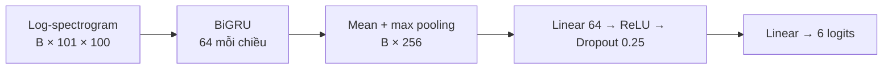
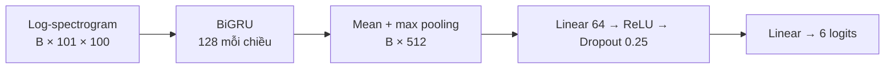
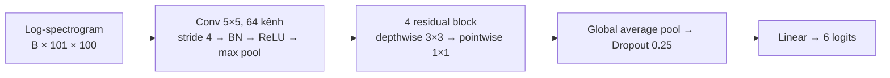

# Chọn model nhận lệnh VoiceSnake

**Chọn DS-CNN vừa** để thử xuất ONNX. Trong lượt so sánh, model này nhận đúng nhiều lệnh nhất sau ngưỡng (70,87%) và có inference backbone CPU p50 0,98 ms. GRU-128 có accuracy 6 lớp nhỉnh hơn và ít nhận nhầm hơn trên nhóm unknown đã thấy. Đây là kết quả của một lần train và chưa chứng minh tốc độ trên browser hay chất lượng production.

## Dữ liệu và đầu vào chung

Speech Commands v0.02: audio mono 16 kHz, mỗi mẫu 16.000 điểm. Frontend dùng STFT (FFT/window 400, hop 160), gộp 200 bin tần số thành 100 bin, lấy log và chuẩn hóa theo từng mẫu. Kết quả là tensor **`[B, 101, 100]`**. Sáu logits theo thứ tự: `up`, `right`, `left`, `down`, `unknown`, `background`.

Split theo speaker bằng SHA-1, khoảng 70/15/15; không dùng split chính thức. `cat`, `dog` là unknown chưa thấy trong validation; `bed`, `bird` là unknown chưa thấy trong test. Tiếng nền được chia theo file trước khi cắt cửa sổ. Test có 2.503 clip lệnh, 4.320 unknown đã thấy, 320 unknown chưa thấy và 61 cửa sổ nền từ một file.

## Bốn kiến trúc

### GRU-64 — 80.582 tham số



### GRU-128 — 209.862 tham số



### DS-CNN nhỏ — 5.382 tham số


### DS-CNN vừa — 21.830 tham số, được chọn



Mỗi residual block gồm depthwise conv → batch norm → ReLU → pointwise conv → batch norm, cộng đầu vào rồi ReLU.

## Thông số train

| Thông số | Giá trị |
|---|---|
| Seed / batch | 42 / 64 |
| Optimizer | AdamW, learning rate 0,001, weight decay 0,0001 |
| Loss | Cross entropy |
| Lịch train | Tối đa 20 epoch; early stopping patience 5; chọn validation loss thấp nhất |
| Scheduler | ReduceLROnPlateau, factor 0,5, patience 2 |
| Mẫu mỗi epoch | 12.000, lấy có hoàn lại và cân bằng theo 6 lớp |
| Augmentation | Che 6 frame thời gian và 5 bin tần số trên feature train |
| Runtime | PyTorch 2.8.0, CPU, 4 luồng |

## Kết quả test

| Model | Epoch tốt nhất | Accuracy 6 lớp | Lệnh đúng được chấp nhận | Unknown đã thấy nhận nhầm | Unknown chưa thấy nhận nhầm | CPU p50 / p95 |
|---|---:|---:|---:|---:|---:|---:|
| GRU-64 | 12 | 87,16% | 54,53% | 0,21% | 0,63% | 1,58 / 1,71 ms |
| GRU-128 | 11 | 89,38% | 67,04% | 0,49% | 1,56% | 2,55 / 2,67 ms |
| DS-CNN nhỏ | 14 | 85,45% | 58,97% | 1,25% | 0,31% | 0,60 / 0,69 ms |
| **DS-CNN vừa** | **10** | **89,03%** | **70,87%** | **1,18%** | **0,94%** | **0,98 / 1,12 ms** |

Accuracy là argmax 6 lớp trước ngưỡng. Các tỷ lệ còn lại dùng ngưỡng riêng, chọn trên validation để không quá 5% trong 320 clip unknown chưa thấy bị nhận thành lệnh. Ngưỡng của DS-CNN vừa là **0,919165**; lệnh chỉ được chấp nhận khi lớp điểm cao nhất là một trong bốn hướng và vượt ngưỡng. Thời gian chỉ đo backbone trên feature tính sẵn, không gồm frontend, micro hoặc detector; đây không phải benchmark ONNX/browser. Dữ liệu test là clip rời, không đo false activation theo giờ.

## Tái lập

Đặt Speech Commands v0.02 trong `archive/`, rồi chạy từ thư mục gốc:

```bash
.venv/bin/python -u experiments/model_comparison/compare.py
```

Checkpoint và [kết quả chi tiết](results.json) của lượt đã chạy được lưu cùng thí nghiệm. Lượt train mới ghi checkpoint, manifest và kết quả vào `training_outputs/model_comparison/`; các model đã có kết quả ở đó được bỏ qua khi chạy lại. Experiment không thay model đang dùng trong game.

## ONNX của DS-CNN vừa

[voicesnake_dscnn_medium.onnx](voicesnake_dscnn_medium.onnx) là checkpoint epoch 10, opset 17, khoảng 720 KiB. Model bao gồm frontend: đầu vào `waveform` float32 `[B, 16000]`, mono 16 kHz; đầu ra `logits` float32 `[B, 6]` theo thứ tự nhãn bên trên. Muốn áp ngưỡng cần softmax và detector ở ứng dụng; ngưỡng 0,919165 là ngưỡng validation của phép thử, chưa được xác nhận trên micro thật.

Frontend ONNX dùng convolution thực để tính STFT thay cho phép STFT phức của PyTorch. Đã kiểm tra ONNX Runtime CPU trên 128 clip test (32 clip mỗi nhóm): sai lệch logits lớn nhất **0,000109**, không khác argmax hoặc quyết định theo ngưỡng. Kiểm tra này không phải chạy trên browser hay đánh giá toàn bộ tập test. Chi tiết trong [onnx_validation.json](onnx_validation.json).

Để xuất và kiểm tra lại, cài `onnx==1.17.0` và `onnxruntime==1.19.2` vào môi trường train, đặt dataset v0.02 trong `archive/`, rồi chạy:

```bash
.venv/bin/python experiments/model_comparison/export_onnx.py
```
